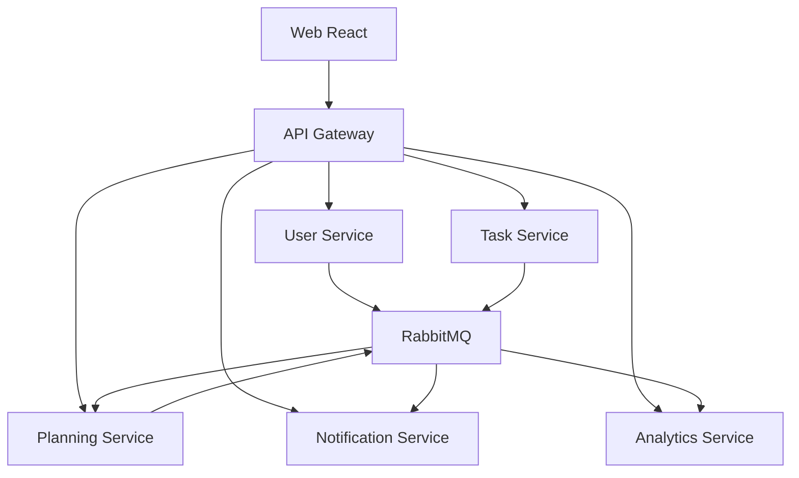

# StudyBalance — Tài liệu chi tiết đề tài

> **Kế hoạch thay đổi cùng bạn.**

- **Tên đề tài:** Xây dựng trợ lý lập kế hoạch học tập cá nhân cho sinh viên theo kiến trúc Microservices hướng sự kiện.
- **Sản phẩm:** Web responsive, ưu tiên desktop cho lập lịch và điện thoại cho thao tác hằng ngày.
- **Quy mô:** Một sinh viên thực hiện.
- **Kiến trúc:** 5 microservice nghiệp vụ, giao tiếp REST và RabbitMQ.
- **Trạng thái tài liệu:** Đặc tả định hướng để thiết kế và triển khai, không phải mô tả hệ thống đã hoàn thành.
- **Phiên bản:** 1.0 — 24/10/2026.

## Mục lục

1. Tổng quan và bài toán
2. Mục tiêu và điểm khác biệt
3. Người dùng và phạm vi
4. Yêu cầu chức năng
5. Luồng nghiệp vụ
6. Thuật toán lập kế hoạch
7. Thiết kế giao diện
8. Kiến trúc 5 microservice
9. Dữ liệu và quyền sở hữu
10. API và hợp đồng sự kiện
11. Nhất quán, chịu lỗi và bảo mật
12. Công nghệ và cấu trúc mã nguồn
13. Kế hoạch triển khai
14. Kiểm thử và demo
15. Sản phẩm bàn giao và rủi ro

## 1. Tổng quan và bài toán

Sinh viên đồng thời quản lý nhiều môn học, bài tập và kỳ thi. Danh sách deadline chỉ cho biết khi nào phải nộp, chưa trả lời nên làm việc gì hôm nay, có đủ thời gian hay không và phải điều chỉnh thế nào khi bị chậm.

StudyBalance chuyển công việc thành các phiên học trong quỹ thời gian thực tế. Người dùng theo dõi tiến độ, thử thay đổi lịch và quyết định áp dụng phương án mới. Hệ thống không cam kết lịch tối ưu tuyệt đối hoặc bảo đảm người dùng hoàn thành mọi deadline.

### Ví dụ xuyên suốt

Sinh viên có bài Mạng máy tính cần 2 giờ, báo cáo Cơ sở dữ liệu cần 4 giờ và ôn thi cần 3 giờ. Quỹ thời gian trước các deadline chỉ có 7 giờ. Hệ thống phải thể hiện phần thiếu 2 giờ, không tự xếp vượt lịch rảnh. Khi sinh viên báo bận một buổi, hệ thống chỉ rõ phiên phải chuyển, deadline bị ảnh hưởng và các lựa chọn bổ sung thời gian.

## 2. Mục tiêu và điểm khác biệt

### 2.1. Mục tiêu sản phẩm

- Trả lời: hôm nay nên làm gì, vì sao và trong bao lâu.
- Đối chiếu khối lượng công việc với thời gian có thể học.
- Hỗ trợ điều chỉnh khi công việc kéo dài hoặc lịch cá nhân thay đổi.
- Đưa ra đánh đổi rõ ràng để người dùng tự quyết định.

### 2.2. Ba điểm nhấn

| Tính năng | Nội dung | Ưu tiên |
|---|---|---|
| Nếu… thì sao? | Mô phỏng nghỉ một buổi, tăng thời lượng hoặc đổi ưu tiên; xem trước/sau | P0 |
| Cứu kế hoạch | Rà soát công việc bị chậm, đề xuất phân bổ lại trong giới hạn thực tế | P0 |
| Ước lượng sát hơn | Dùng lịch sử thời gian thực hiện để gợi ý thời gian dự phòng | P1 |

P0 là phạm vi cần hoàn thành; P1 thực hiện sau khi luồng chính và cơ chế phân tán ổn định. Các tính năng tương tự có thể tồn tại ở sản phẩm khác; điểm nhấn của đề tài là cách kết hợp và áp dụng cho sinh viên, không phải tuyên bố phát minh mới.

### 2.3. Mục tiêu học thuật

Triển khai dịch vụ độc lập; truyền sự kiện bất đồng bộ; xử lý giao tin lặp, mất kết nối, dữ liệu đến chậm; kiểm soát phiên bản kế hoạch; đo và giải thích hành vi khi lỗi.

## 3. Người dùng và phạm vi

### 3.1. Người dùng chính

Sinh viên tự quản lý lịch học và bài tập, thường có nhiều deadline, quỹ thời gian thay đổi và chưa ước lượng công việc chính xác.

Bản đầu chỉ có vai trò người dùng cá nhân. Không cần xây admin dashboard nghiệp vụ riêng; công cụ xem broker, log và health dành cho người vận hành.

### 3.2. Phạm vi P0

- Tài khoản và xác thực.
- Môn học, công việc, bước nhỏ và phụ thuộc.
- Lịch rảnh lặp lại, lịch bận và ngoại lệ theo ngày.
- Lập kế hoạch, trang Hôm nay và ghi nhận phiên học.
- Mô phỏng thay đổi, cứu kế hoạch, xác nhận phương án.
- Nhắc việc trong ứng dụng và thống kê cơ bản.
- Đầy đủ 5 microservice với luồng sự kiện, phục hồi và kiểm thử.

### 3.3. Phạm vi P1

Check-in năng lượng tự nguyện; gợi ý thời gian dự phòng; PWA; email nhắc việc; kéo thả lịch nâng cao.

### 3.4. Ngoài phạm vi bản đầu

Làm việc nhóm, chat, thanh toán, AI chatbot, đồng bộ Google Calendar, kết nối hệ thống trường, ứng dụng native, đánh giá hoặc chẩn đoán sức khỏe tinh thần. Không cần thêm AI để tạo giá trị cốt lõi.

## 4. Yêu cầu chức năng

| Mã | Nhóm | Yêu cầu và điều kiện chính |
|---|---|---|
| FR01 | Tài khoản | Đăng ký, đăng nhập, làm mới phiên và đăng xuất; dữ liệu chỉ thuộc chủ tài khoản |
| FR02 | Thiết lập | Chọn múi giờ, độ dài phiên, thời gian nghỉ, giới hạn tự học mỗi ngày |
| FR03 | Lịch cá nhân | Tạo lịch rảnh tuần; khai báo giờ bận; thêm ngoại lệ riêng từng ngày |
| FR04 | Môn học | Thêm, sửa, lưu trữ; tên và màu nhận diện |
| FR05 | Công việc | Tên, môn, deadline, ưu tiên, thời lượng dự kiến/còn lại, ghi chú, trạng thái |
| FR06 | Bước nhỏ | Chia việc và xác định phụ thuộc; từ chối vòng lặp phụ thuộc |
| FR07 | Lập kế hoạch | Sinh bản đề xuất, kèm phần chưa xếp được và lý do |
| FR08 | Xác nhận | Chỉ kế hoạch đã xác nhận mới trở thành lịch hoạt động và tạo nhắc |
| FR09 | Thực hiện | Bắt đầu, tạm dừng, kết thúc hoặc bỏ lỡ phiên; lưu thời gian thực tế |
| FR10 | Tiến độ | Người dùng xác nhận trạng thái và thời lượng còn lại; không tự coi hết phiên là xong việc |
| FR11 | Mô phỏng | Thử thay đổi mà không sửa dữ liệu thật; so sánh phiên thêm/chuyển/bỏ và tác động deadline |
| FR12 | Cứu kế hoạch | Gợi ý phương án khi bị chậm; giữ giới hạn hoặc đề xuất bổ sung thời gian có xác nhận |
| FR13 | Khóa phiên | Giữ phiên khi tính lại; báo xung đột nếu lịch bận mới trùng phiên khóa |
| FR14 | Thông báo | Nhắc phiên, deadline và kế hoạch; đánh dấu đã đọc; hủy lịch nhắc lỗi thời |
| FR15 | Thống kê | Tổng thời gian, phân bổ theo môn, tỷ lệ đúng hạn, dự kiến/thực tế và tổng kết tuần |

### Quy tắc dữ liệu đầu vào

- Thời lượng phải dương; dùng phút làm đơn vị nội bộ.
- Công việc chưa ước lượng vẫn được lưu, nhưng chưa được xếp lịch và phải có nhãn cần bổ sung.
- Công việc quá hạn vẫn hiển thị; không lặng lẽ đẩy deadline sang tương lai.
- Bước nhỏ được lập lịch thì công việc cha chỉ tổng hợp, tránh cộng thời lượng hai lần.
- Lưu thời điểm tuyệt đối bằng UTC; lịch rảnh lặp lại được diễn giải theo múi giờ người dùng.
- Lưu trữ môn không tự xóa lịch sử công việc.

## 5. Luồng nghiệp vụ

### 5.1. Onboarding

Đăng ký → nhập lịch học/bận → khai báo khoảng tự học → thêm công việc → tạo đề xuất → xem trước → xác nhận. Cho phép bỏ qua bước, nhưng hiển thị dữ liệu còn thiếu trước khi lập lịch.

### 5.2. Lập kế hoạch ngày thường

Người dùng mở Hôm nay, xem việc tiếp theo và lý do ưu tiên, thực hiện phiên, ghi nhận thời gian và phần việc còn lại. Hệ thống đề xuất tính lại nếu cần; không tự dịch chuyển các phiên đã xác nhận mà không thông báo.

### 5.3. Hôm nay tôi bận

1. Chọn khoảng bận hoặc toàn bộ phần còn lại của ngày.
2. Planning tạo kịch bản tạm, không sửa lịch rảnh thật.
3. Hiển thị lịch trước/sau và tác động.
4. Người dùng sửa hoặc chọn áp dụng.
5. User Service ghi nhận ngoại lệ lịch bận qua yêu cầu có mã chống trùng.
6. Planning đợi sự kiện xác nhận thay đổi, kiểm tra phiên bản rồi kích hoạt phương án hoặc tính lại.
7. Giao diện thể hiện đang áp dụng cho tới khi hoàn tất; Notification cập nhật lịch nhắc.

Không giả định hai database có thể cập nhật nguyên tử. Nếu thay đổi nguồn đã lưu nhưng bước kích hoạt lỗi, giữ kế hoạch cũ ở trạng thái cần cập nhật và cho phép thử lại; không báo thành công sớm.

### 5.4. Cứu kế hoạch

Rà soát phiên bỏ lỡ → cập nhật thời lượng còn lại → chọn mục tiêu → xem đề xuất → xác nhận. Các phương án gồm giữ deadline bằng cách đề nghị bổ sung giờ, giữ giới hạn học với phần chưa xếp được, hoặc ưu tiên một việc. Không tự thêm giờ ngoài lịch rảnh hoặc đổi deadline.

### 5.5. Dữ liệu thay đổi trong lúc xem trước

Bản đề xuất lưu snapshot phiên bản đầu vào. Nếu công việc, lịch rảnh hoặc lịch hoạt động đã đổi trước khi xác nhận, từ chối áp dụng bản cũ và yêu cầu tính lại. Việc kiểm tra dùng bản sao đã đồng bộ; giao diện phải cho biết trạng thái đang đồng bộ. Đây là nhất quán cuối cùng, không phải giao dịch toàn cục.

## 6. Thuật toán lập kế hoạch

### 6.1. Đầu vào

Công việc và bước nhỏ còn mở; thời lượng còn lại; deadline; ưu tiên; phụ thuộc; khoảng rảnh và lịch bận; giới hạn ngày; độ dài phiên/nghỉ; phiên khóa; khoảng lập kế hoạch do người dùng chọn.

### 6.2. Ràng buộc cứng

- Không chồng lấn phiên hoặc trùng lịch bận.
- Không vượt quỹ thời gian và giới hạn ngày.
- Không đổi phiên hoàn thành hoặc tự chuyển phiên khóa.
- Thực hiện phụ thuộc theo thứ tự.
- Không xếp vào quá khứ.
- Phần không thể xếp trước hạn phải được nêu rõ.

### 6.3. Heuristic bản đầu

1. Chuẩn hóa đầu vào, kiểm tra phụ thuộc bằng sắp xếp topo.
2. Tính các khoảng khả dụng, trừ giờ bận và các phiên cố định.
3. Xác định công việc đủ điều kiện; ưu tiên deadline gần, rồi ưu tiên người dùng và thứ tự ổn định.
4. Chia thời lượng thành phiên, tìm vị trí khả dụng trước deadline và sau tiền đề.
5. Chèn khoảng nghỉ; ghi phiên với lý do lựa chọn.
6. Lặp cho các công việc còn lại.
7. Trả về lịch và danh sách chưa xếp đủ, lý do và số phút thiếu.

Đây là thuật toán heuristic: kết quả thiếu chỗ không luôn chứng minh bài toán không có nghiệm. Với trường hợp phức tạp, mô tả là “chưa xếp được theo phương án hiện tại”; có thể thử thứ tự khác hoặc cho người dùng điều chỉnh. Chỉ khẳng định thiếu tổng quỹ thời gian khi phép tính thực sự cho thấy điều đó.

### 6.4. Đầu ra và giải thích

Mỗi phiên có taskId, thời gian bắt đầu/kết thúc và lý do như hạn gần, bước tiền đề hoặc phiên khóa. Kết quả kèm tổng phút đã xếp, chưa xếp, deadline bị ảnh hưởng và các xung đột.

### 6.5. Phiên bản và mô phỏng

- Mỗi thay đổi nguồn tăng version của aggregate; sự kiện mang version.
- Mỗi yêu cầu lập lịch có generation và bộ phiên bản đầu vào.
- Chỉ kết quả còn phù hợp với generation hiện tại được công bố.
- Có thể gộp các yêu cầu cập nhật liên tiếp để tránh tính thừa.
- Bản mô phỏng không tạo nhắc hoặc thay thế kế hoạch hoạt động.
- Chỉ một bản kế hoạch hoạt động cho mỗi người dùng; xác nhận dùng optimistic concurrency.

## 7. Thiết kế giao diện

### 7.1. Nguyên tắc

Giao diện sáng, nền trung tính, màu nhận diện môn học; khoảng trống rõ; luôn kèm chữ/số với màu cảnh báo. Không hiển thị thuật ngữ broker, worker hoặc event vào luồng người dùng.

Tham khảo định hướng: Sunsama cho lập kế hoạch web; Structured cho timeline ngày; MyStudyLife cho môn học và deadline. Đây là nguồn cảm hứng, không sao chép nguyên bố cục hoặc nhận diện thương hiệu.

### 7.2. Các màn hình

| Màn hình | Nội dung chính |
|---|---|
| Đăng nhập/đăng ký | Form và thông báo lỗi rõ ràng |
| Thiết lập ban đầu | Lịch rảnh, lịch bận, sở thích phiên học |
| Hôm nay | Một việc nên bắt đầu, timeline, tiến độ, báo bận |
| Công việc | Bộ lọc môn, deadline, trạng thái; thêm nhanh |
| Chi tiết công việc | Ước lượng, phần còn lại, bước nhỏ, phụ thuộc |
| Lịch tuần | Phiên, lịch bận, khoảng trống và danh sách chưa xếp |
| Thử thay đổi | Nhập giả định và so sánh trước/sau |
| Cứu kế hoạch | Lý do lệch, các phương án và đánh đổi |
| Thống kê | Thực tế/dự kiến, theo môn, tổng kết tuần |
| Thông báo/cài đặt | Lịch nhắc, đã đọc, tùy chọn tài khoản |

### 7.3. Bố cục lịch tuần

Desktop: sidebar trái; lịch ở giữa; panel phải chứa chi tiết hoặc công việc chưa xếp. Mobile: mặc định chế độ ngày, thêm nhanh và Hôm nay; không ép bảy cột tuần vào màn hình nhỏ.

### 7.4. Trạng thái cần thiết kế

Không có dữ liệu; thiếu ước lượng; đang tính; đang đồng bộ; kế hoạch cũ; không đủ thời gian; xung đột phiên khóa; lỗi thử lại; áp dụng thành công. Ưu tiên thiết kế luồng thêm việc → lịch tuần → Hôm nay → báo bận → so sánh → áp dụng.

## 8. Kiến trúc 5 microservice



Sơ đồ chỉ biểu diễn giao tiếp chính. Mỗi service có database riêng, không vẽ toàn bộ để giữ dễ đọc. Sơ đồ chi tiết bằng PlantUML (triển khai, bản đồ sự kiện, outbox/inbox, mô phỏng, xác thực, chịu lỗi), so sánh kiến trúc và case study: [docs/architecture](docs/architecture/README.md).

| Service | Trách nhiệm | Không phụ trách |
|---|---|---|
| User | Tài khoản, refresh token, lịch rảnh/bận, thiết lập | Công việc và thuật toán lịch |
| Task | Môn, công việc, bước nhỏ, phụ thuộc, tiến độ | Phiên học và báo cáo tổng hợp |
| Planning | Lịch, mô phỏng, phiên học và ghi nhận thời gian | Sửa trực tiếp deadline hoặc lịch rảnh |
| Notification | Lịch nhắc, thông báo và trạng thái gửi | Quyết định thứ tự công việc |
| Analytics | Projection sự kiện, thống kê và gợi ý dự phòng | Cập nhật dữ liệu nguồn |

Dịch vụ được triển khai độc lập. Có thể dùng monorepo; chung repository không có nghĩa chung tiến trình. API Gateway, RabbitMQ và MySQL không tính vào năm microservice nghiệp vụ.

## 9. Dữ liệu và quyền sở hữu

| Database | Các bảng dự kiến |
|---|---|
| user_db | users, refresh_tokens, availability_rules, busy_periods, date_exceptions, preferences |
| task_db | subjects, tasks, subtasks, task_dependencies, progress_updates |
| planning_db | plans, plan_versions, study_sessions, session_logs, simulations, task_projection, availability_projection |
| notification_db | notifications, reminders, delivery_attempts, processed_events |
| analytics_db | task_facts, session_facts, daily_summaries, weekly_summaries, processed_events |

Các service phát sự kiện có outbox; service nhận có inbox/processed_events theo nhu cầu. Một MySQL instance chứa năm database với năm tài khoản giới hạn quyền là cấu hình đồ án; đây vẫn là điểm lỗi chung, chưa phải database HA.

Quy tắc sở hữu:

- Task là nguồn chuẩn cho trạng thái và thời lượng còn lại.
- Planning là nguồn chuẩn cho phiên dự kiến và thời gian thực hiện.
- Kết thúc phiên chỉ ghi nhận thời gian; cập nhật phần còn lại là thao tác rõ ràng tới Task.
- Nếu hai thao tác không cùng thành công, UI giữ thời gian đã ghi và cho phép cập nhật tiến độ lại; không giả định giao dịch xuyên service.
- Analytics chỉ giữ dữ liệu cần thống kê, không truy vấn trực tiếp bảng nguồn.
- ID liên dịch vụ không có foreign key xuyên database; kiểm tra bằng hợp đồng nghiệp vụ và projection.

## 10. API và hợp đồng sự kiện

### 10.1. REST API dự kiến

| Service | Endpoint ví dụ |
|---|---|
| User | POST /auth/register, /auth/login, /auth/refresh, /auth/logout |
| User | GET/PATCH /me; GET/PUT /me/availability; POST /me/busy-periods |
| Task | GET/POST /subjects; GET/POST /tasks; GET/PATCH/DELETE /tasks/:id |
| Task | POST /tasks/:id/subtasks; PATCH /tasks/:id/progress |
| Planning | POST /plans/generate; GET /plans/current; GET /study-sessions |
| Planning | POST /simulations; GET /simulations/:id; POST /simulations/:id/apply |
| Planning | POST /study-sessions/:id/start; POST /study-sessions/:id/finish |
| Notification | GET /notifications; PATCH /notifications/:id/read |
| Analytics | GET /analytics/weekly; GET /analytics/subjects |

Đây là hợp đồng dự thảo. Tác vụ tính lịch trả 202 và jobId; UI lấy trạng thái qua polling ở bản đầu. Dùng phân trang, validation và mã lỗi thống nhất. Các thao tác có nguy cơ lặp dùng Idempotency-Key và scope theo người dùng.

### 10.2. Sự kiện

| Sự kiện | Nguồn | Consumer chính |
|---|---|---|
| TaskCreated/Updated/Deleted | Task | Planning; Analytics theo dữ liệu cần |
| TaskProgressUpdated | Task | Planning, Analytics |
| AvailabilityUpdated | User | Planning |
| PreferencesUpdated | User | Planning; Notification theo tùy chọn |
| PlanConfirmed/PlanUpdated | Planning | Notification |
| StudySessionCompleted | Planning | Analytics |

TaskDeleted mang tombstone/version để hủy dữ liệu lịch và nhắc liên quan. Notification ưu tiên lấy deadline đã xác nhận từ sự kiện kế hoạch; không tạo hai hệ lịch nhắc cạnh tranh.

### 10.3. Envelope mẫu

```json
{
  "eventId": "uuid",
  "eventType": "TaskUpdated",
  "schemaVersion": 1,
  "occurredAt": "2026-10-24T08:00:00Z",
  "producer": "task-service",
  "aggregateId": "task-uuid",
  "aggregateVersion": 4,
  "userId": "user-uuid",
  "correlationId": "request-uuid",
  "payload": {
    "deadline": "2026-10-28T16:59:00Z",
    "remainingMinutes": 180
  }
}
```

EventId phục vụ chống trùng; aggregateVersion xử lý cập nhật cũ; schemaVersion quản lý thay đổi cấu trúc. Event payload chỉ chứa dữ liệu consumer cần. Khi dùng snapshot đầy đủ thì có thể bỏ phiên bản cũ; nếu dùng delta và thiếu phiên bản phải có cơ chế đồng bộ lại, không bỏ qua tùy tiện.

## 11. Nhất quán, chịu lỗi và bảo mật

### 11.1. Phát và nhận tin — Transactional Outbox

1. Giao dịch nguồn lưu thay đổi và outbox cùng lúc.
2. Publisher chuyển outbox sang exchange bền vững, dùng persistent message và publisher confirms.
3. Chỉ đánh dấu đã phát sau khi xác nhận; phát lại có thể xảy ra.
4. Consumer lưu eventId cùng tác động dữ liệu trong giao dịch local.
5. ACK sau commit; retry có giới hạn với backoff; lỗi kéo dài vào DLQ.

Định hướng là giao ít nhất một lần và xử lý idempotent, không hứa exactly-once toàn cục. Queue/exchange/binding phải được khai báo bền vững. Mỗi consumer nghiệp vụ có queue riêng; nhiều replica cùng consumer dùng chung queue để chia tải.

### 11.2. Nhắc việc

Lịch nhắc lưu trong notification_db, không phụ thuộc timer trong RAM. Scheduler nhận việc bằng claim/lease nguyên tử; khóa duy nhất gồm người dùng, phiên, loại nhắc và revision. Hủy nhắc cũ khi kế hoạch thay đổi; kiểm tra revision trước khi tạo thông báo.

Thông báo trong app có thể chống trùng bằng unique key. Kênh email/push ngoài hệ thống vẫn có cửa sổ gửi thành công nhưng chưa lưu xác nhận; cần mô tả giới hạn thay vì cam kết tuyệt đối không gửi trùng.

### 11.3. Xác thực và dữ liệu

- Băm mật khẩu; không lưu mật khẩu thô.
- Kiểm tra JWT và quyền sở hữu ở mỗi service, không chỉ gateway.
- Refresh token được bảo vệ; cookie HttpOnly/Secure và CSRF nếu dùng cookie xác thực.
- Validation, giới hạn tần suất đăng nhập, CORS theo môi trường.
- Không log token, mật khẩu hoặc nội dung riêng tư không cần thiết.
- Secrets qua biến môi trường, không commit .env thật.
- Chỉ gateway mở cổng nghiệp vụ ra ngoài; broker/database trong mạng nội bộ.

### 11.4. Quan sát và giới hạn triển khai

Health/readiness endpoint, log JSON có service và correlationId; theo dõi độ sâu queue, DLQ, retry và độ trễ lập lịch. Một máy chạy Docker Compose đủ demo tiến trình phân tán nhưng không chứng minh khả năng chịu mất toàn bộ máy chủ. Nếu môn yêu cầu nhiều máy phải triển khai bổ sung theo tiêu chí giảng viên.

## 12. Công nghệ và cấu trúc mã nguồn

| Thành phần | Công nghệ |
|---|---|
| Frontend | React, TypeScript, Vite |
| UI | Tailwind CSS, shadcn/ui |
| API state | TanStack Query |
| Backend | Node.js, Express, TypeScript |
| Database/ORM | MySQL, Prisma |
| Broker | RabbitMQ |
| Gateway | Nginx |
| API documentation | OpenAPI/Swagger |
| Chạy hệ thống | Docker Compose |

Phiên bản thư viện và thư viện lịch UI cần được lựa chọn, kiểm tra license và khóa bằng lockfile lúc triển khai; tài liệu không khẳng định phiên bản mới nhất.

```text
studybalance/
├── frontend/
├── services/
│   ├── user-service/
│   ├── task-service/
│   ├── planning-service/
│   ├── notification-service/
│   └── analytics-service/
├── packages/
│   └── event-contracts/
├── infrastructure/
│   ├── nginx/
│   ├── rabbitmq/
│   └── mysql/
├── docs/
│   ├── architecture/
│   ├── api/
│   └── test-results/
├── docker-compose.yml
├── .env.example
└── README.md
```

Mỗi service có Dockerfile, schema/migration, test và cấu hình riêng. Chỉ chia sẻ contract và tiện ích nhỏ; không chia sẻ ORM model để ghép chặt các database.

## 13. Kế hoạch triển khai

Lịch tham khảo tám tuần, tính từ khi bắt đầu; chưa có deadline môn học nên không ấn định ngày giao.

| Tuần | Công việc | Mốc nghiệm thu |
|---|---|---|
| 1 | Chốt use case, wireframe, dữ liệu, event/API contracts và quy tắc lịch | Một kịch bản xuyên suốt rõ ràng |
| 2 | Monorepo, Compose, gateway, User, xác thực và lịch cá nhân | Đăng nhập và khai báo lịch được |
| 3 | Task, môn, bước nhỏ, thời lượng, outbox và projection ban đầu | Công việc truyền tới Planning |
| 4 | Heuristic, plan version, lịch tuần và xem trước | Sinh lịch thỏa ràng buộc cơ bản |
| 5 | Hôm nay, phiên học, mô phỏng và cứu kế hoạch | Hoàn thành luồng đặc trưng |
| 6 | Notification, Analytics và tổng kết tuần | Đủ 5 service hoạt động |
| 7 | Retry/DLQ, kiểm thử version, phục hồi, concurrency và đo hiệu năng | Có bằng chứng phân tán |
| 8 | Responsive, sửa lỗi, báo cáo, hướng dẫn và video demo | Bộ nộp chạy lại được |

Outbox/idempotency cần có ngay từ luồng đầu; tuần 7 là củng cố và kiểm thử. Nếu trễ, cắt P1 trước, không cắt cơ chế phân tán cốt lõi hoặc chuyển toàn bộ thành CRUD.

## 14. Kiểm thử và demo

### 14.1. Ma trận kiểm thử

| Nhóm | Tình huống | Kết quả mong muốn |
|---|---|---|
| Lập lịch | Nhiều việc cùng hạn | Không chồng giờ; phần thiếu rõ ràng |
| Phụ thuộc | A trước B; nhập vòng A-B-A | B xếp sau A; vòng bị từ chối |
| Lịch cá nhân | Ngoại lệ ngày, phiên khóa trùng bận | Tôn trọng ngoại lệ; yêu cầu xử lý xung đột |
| Mô phỏng | Nghỉ hôm nay | Không sửa lịch thật trước xác nhận |
| Phiên bản | Sửa task khi đang tính | Kết quả cũ không thành lịch mới |
| Giao tin | Cùng event gửi hai lần | Không nhân đôi tác động |
| Thứ tự | Bản version 3 tới sau 4 | Projection không bị lùi |
| Worker lỗi | Dừng Planning rồi cập nhật task | Sau khôi phục nhận và xử lý tác vụ |
| Broker lỗi | Tạo task khi RabbitMQ dừng | Task/outbox lưu; phát sau khôi phục |
| Consumer lỗi | Lỗi sau commit, trước ACK | Giao lại nhưng không lặp dữ liệu |
| Nhắc lịch | Kế hoạch đổi trước giờ nhắc | Nhắc cũ được hủy hoặc bỏ qua theo revision |
| Quyền truy cập | User A gọi tài nguyên B | Bị từ chối |
| Analytics | Dừng rồi bật consumer | Tổng hợp bù, không đếm trùng |

### 14.2. Đo lường

Đo thời gian tạo đề xuất, độ trễ task-update tới plan-ready, số tác vụ xử lý/giây và thời gian phục hồi backlog. Dùng tập dữ liệu cố định, ghi cấu hình máy, số lần chạy và trung vị/p95 khi đủ mẫu. Mục tiêu hiệu năng chỉ đặt sau baseline, không tự điền kết quả giả.

So sánh một và hai worker với nhiều người dùng độc lập; không khẳng định thêm worker luôn nhanh hơn vì có thể bị giới hạn CPU/database. Kiểm thử dữ liệu lớn không làm thay đổi tiêu chí tính đúng.

### 14.3. Kịch bản bảo vệ

1. Đăng nhập với dữ liệu mẫu ba môn và nhiều deadline.
2. Sinh lịch tuần, giải thích thứ tự ưu tiên và phần chưa xếp được.
3. Báo bận một buổi; xem trước/sau và đánh đổi.
4. Chọn phương án, xác nhận, theo dõi lịch nhắc cập nhật.
5. Ghi một phiên thực tế dài hơn dự kiến; tính lại lịch.
6. Dừng Planning, sửa deadline, bật lại và quan sát phục hồi.
7. Giao lại sự kiện, chứng minh không trùng; mở log correlationId và thống kê.

## 15. Sản phẩm bàn giao và rủi ro

### 15.1. Bộ bàn giao

- Mã nguồn frontend và đủ năm service.
- Docker Compose, .env.example, migration và seed dữ liệu.
- README chạy từ môi trường sạch và tài khoản demo.
- OpenAPI, event contracts và hướng dẫn xử lý DLQ.
- Sơ đồ kiến trúc, sequence các luồng chính, ERD theo service.
- Đặc tả thuật toán và giới hạn heuristic.
- Kết quả kiểm thử, số liệu thực nghiệm, video và slide bảo vệ.

### 15.2. Rủi ro và hướng xử lý

| Rủi ro | Hướng xử lý |
|---|---|
| Một người triển khai năm service | Giữ chức năng gọn, cùng stack, xây từng luồng dọc |
| Thuật toán quá phức tạp | Heuristic giải thích được, kiểm thử ràng buộc trước tối ưu |
| Ước lượng đầu vào sai | Cho cập nhật phần còn lại; dự phòng là tùy chọn |
| Độ trễ đồng bộ làm UI khó hiểu | Hiển thị trạng thái cập nhật và phiên bản |
| Phạm vi tăng | Đóng P0, để AI/mobile/tích hợp ngoài sang sau |
| Hạ tầng chung bị dừng | Nêu rõ giới hạn; không đánh đồng Compose với HA |
| Yêu cầu môn chưa rõ | Đối chiếu rubric, công nghệ bắt buộc và số máy trước triển khai |

### 15.3. Tiêu chí hoàn thành bản đầu

- Người dùng tự nhập công việc, lịch rảnh và nhận kế hoạch có giải thích.
- Kế hoạch không vi phạm ràng buộc cứng và biểu diễn phần chưa xếp.
- Mô phỏng không thay đổi dữ liệu thật; xác nhận xử lý xung đột phiên bản.
- Cả năm service có trách nhiệm và dữ liệu riêng, chạy độc lập.
- Luồng sự kiện chịu được giao lặp và gián đoạn trong các kịch bản đã kiểm thử.
- Dữ liệu cá nhân được phân quyền; báo cáo, demo và hướng dẫn có thể tái hiện.

## 16. Mô tả ngắn để đăng ký đề tài

StudyBalance là hệ thống web hỗ trợ sinh viên quản lý công việc và lập kế hoạch học tập cá nhân dựa trên deadline, thời lượng còn lại và quỹ thời gian khả dụng. Hệ thống cho phép mô phỏng thay đổi, đánh giá tác động và điều chỉnh kế hoạch khi bị chậm, đồng thời cung cấp nhắc việc và thống kê học tập. Sản phẩm được xây dựng theo kiến trúc năm microservice gồm User, Task, Planning, Notification và Analytics, giao tiếp qua REST API và RabbitMQ. Đề tài tập trung vào xử lý bất đồng bộ, nhất quán cuối cùng, chống xử lý trùng, kiểm soát phiên bản và phục hồi khi dịch vụ gặp lỗi.
