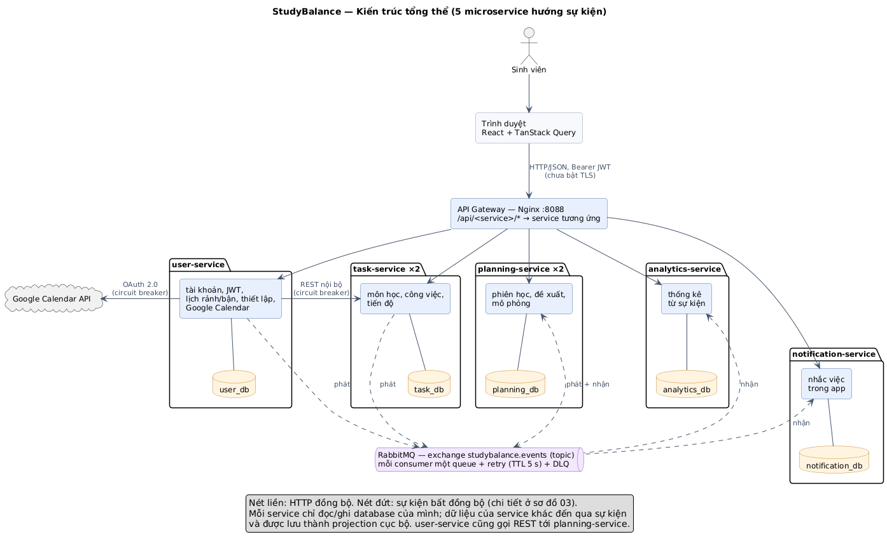

# Kiến trúc StudyBalance

Sơ đồ viết bằng PlantUML (`*.puml`), có sẵn bản `.svg` và `.png`. Sửa file `.puml` rồi chạy `npm run docs:diagrams` để render lại (cần Docker).

| # | Sơ đồ | Nội dung |
|---|---|---|
| 01 | [Tổng quan](01-tong-quan.png) | 5 microservice, mỗi service một database, gateway, RabbitMQ, Google Calendar |
| 02 | [Triển khai](02-trien-khai.png) | Container trong Docker Compose: bản sao, MySQL primary/replica, backup, Prometheus, Grafana |
| 03 | [Bản đồ sự kiện](03-ban-do-su-kien.png) | Service nào phát và nhận sự kiện nào; queue, retry, DLQ |
| 04 | [Outbox → Inbox](04-outbox-inbox.png) | Tạo công việc; RabbitMQ ngắt; handler lỗi → retry → DLQ |
| 05 | [Mô phỏng "Nếu… thì sao?"](05-mo-phong.png) | Xem trước, phát hiện dữ liệu đã đổi (`SIMULATION_STALE`), áp dụng |
| 06 | [Xác thực](06-xac-thuc.png) | JWT 15 phút, refresh token xoay vòng, phát hiện token bị dùng lại |
| 07 | [Chịu lỗi](07-chiu-loi.png) | Bản sao chết qua gateway; circuit breaker giữa các service |
| 08 | [Circuit breaker](08-circuit-breaker.png) | Trạng thái Closed / Open / HalfOpen |
| 09 | [Thông báo thời gian thực](09-thong-bao-realtime.png) | SSE qua gateway, gửi sau commit, tự kết nối lại |

## Vì sao chọn microservice hướng sự kiện

| | Monolith | SOA | Microservice | Hướng sự kiện |
|---|---|---|---|---|
| Đơn vị triển khai | Một ứng dụng | Service lớn theo chức năng doanh nghiệp | Service nhỏ theo một nghiệp vụ, triển khai độc lập | Thường kết hợp với microservice |
| Giao tiếp | Gọi hàm trong tiến trình | Thường qua ESB, SOAP/XML; ESB chứa cả logic định tuyến và chuyển đổi | REST/gRPC trực tiếp, "smart endpoints, dumb pipes" | Phát sự kiện qua broker; bên phát không biết ai nhận |
| Dữ liệu | Một database | Thường dùng chung database | Mỗi service một database | Bên nhận tự giữ bản sao (projection) |
| Nhất quán | Transaction ACID | ACID hoặc transaction phân tán | Nhất quán cuối cùng giữa các service | Nhất quán cuối cùng |
| Khi một phần hỏng | Cả hệ thống bị ảnh hưởng | ESB là điểm nghẽn chung | Hỏng cục bộ nếu có cách ly (timeout, circuit breaker) | Bên nhận chết thì sự kiện chờ trong queue |

StudyBalance kết hợp hai kiểu cuối:

- **Lệnh từ người dùng đi qua REST đồng bộ**, vì người dùng cần biết ngay lệnh thành công hay thất bại: tạo công việc, xếp phiên học.
- **Thay đổi lan sang service khác qua sự kiện**. Ví dụ: Task phát `TaskCreated`, sau đó Planning, Notification và Analytics tự cập nhật. Nhờ vậy Task không phụ thuộc vào ba service kia. Notification chết không làm hỏng việc tạo công việc, và thêm một consumer mới không cần sửa Task.
- **Không dùng SOA với ESB.** Với 5 service do một người làm, ESB thêm một thành phần trung tâm phải vận hành mà không đem lại lợi ích. RabbitMQ chỉ chuyển tin; logic nằm trong service.
- **Cái giá phải trả là nhất quán cuối cùng.** Planning có thể chưa nhận `TaskCreated` khi người dùng xếp phiên ngay sau khi tạo công việc. Hệ thống trả `409 TASK_NOT_SYNCED` thay vì đoán dữ liệu, và frontend thử lại sau.

## Case study

### Netflix: từ monolith sang microservice trên cloud

- **Bối cảnh:** năm 2008, một sự cố hỏng database khiến Netflix không gửi được đĩa DVD trong vài ngày. Sau đó công ty chuyển dần từ một ứng dụng monolith trong datacenter riêng sang hàng trăm microservice trên AWS. Quá trình này hoàn tất khoảng năm 2016.
- **Các công cụ được công bố mã nguồn mở:**
  - Hystrix: circuit breaker, cách ly lỗi giữa các service.
  - Eureka: service registry.
  - Chaos Monkey: tắt ngẫu nhiên máy chủ đang chạy thật để buộc hệ thống chịu được lỗi.
  - Hystrix ngừng phát triển từ 2018; Netflix khuyến nghị chuyển sang Resilience4j.
- **Áp dụng vào StudyBalance:**
  - Circuit breaker trong [`circuitBreaker.ts`](../../packages/service-kit/src/circuitBreaker.ts) theo đúng mô hình closed → open → half-open của Hystrix.
  - Thay Eureka bằng DNS của Docker. Prometheus và Nginx đều tìm bản sao qua DNS, đủ cho quy mô một máy.
  - Phép thử tắt bản sao và tắt RabbitMQ là phiên bản nhỏ của tinh thần Chaos Monkey ([kết quả](../test-results/2026-11-10-fault-tolerance.md)).

### Uber: khi có quá nhiều microservice

- **Bối cảnh:** Uber tách ứng dụng ban đầu thành hàng nghìn microservice, rồi gặp khó vì một thay đổi phải sửa nhiều service và khó truy ra lỗi qua chuỗi gọi dài. Năm 2020, Uber công bố DOMA (Domain-Oriented Microservice Architecture):
  - Gom service thành các domain theo nghiệp vụ.
  - Mỗi domain có một gateway duy nhất.
  - Phân lớp để hạn chế phụ thuộc giữa các domain.
- **Áp dụng vào StudyBalance:**
  - Chỉ tách 5 service theo 5 nghiệp vụ rõ ràng, không tách nhỏ hơn.
  - Mỗi service sở hữu trọn dữ liệu của mình.
  - Bảng "Không phụ trách" trong [đặc tả mục 8](../../StudyBalance_Chi_tiet_de_tai.md#8-kiến-trúc-5-microservice) giữ ranh giới đó.
  - `correlationId` đi theo request và sự kiện, nên vẫn lần theo được một thao tác qua nhiều service.

### Mẫu Transactional Outbox

Đây là mẫu thiết kế đã được mô tả rộng rãi trong tài liệu microservice, ví dụ microservices.io của Chris Richardson. Nó giải quyết bài toán "ghi database rồi gửi tin nhắn": nếu service chết giữa hai bước thì database và broker lệch nhau.

Ở StudyBalance:
- Sự kiện được ghi vào bảng `outbox` trong cùng transaction với dữ liệu nghiệp vụ, rồi một relay chuyển sang RabbitMQ.
- Phía nhận dùng bảng `processed_events` (inbox) để xử lý mỗi sự kiện đúng một lần, dù broker có giao lại nhiều lần.
- Xem [sơ đồ 04](04-outbox-inbox.png).

### Bài học rút ra cho quy mô đề tài

1. Microservice đem lại khả năng triển khai và chịu lỗi độc lập, nhưng phải trả giá bằng nhất quán cuối cùng, nhiều thành phần vận hành và khó gỡ lỗi. Các hệ thống lớn đều phải xây công cụ quan sát và cách ly lỗi song song với việc tách service.
2. Với 5 service, các cơ chế đó được làm ở mức tương ứng:
   - Outbox/inbox thay cho giao dịch phân tán.
   - Circuit breaker và nhiều bản sao sau Nginx.
   - Prometheus và Grafana thay cho hệ thống giám sát riêng.
   - Sao lưu cùng replica MySQL.

## Tài liệu liên quan

- [Đặc tả đề tài](../../StudyBalance_Chi_tiet_de_tai.md)
- [API và sự kiện](../api/README.md)
- [Sao lưu, khôi phục, replica](../backup.md)
- [Chịu lỗi và giám sát](../fault-tolerance.md)
